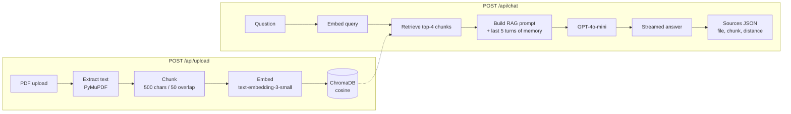

# rag-chatbot

Document Q&A chatbot that answers from your own PDFs and streams replies with source citations, with a customer-support persona and a built-in demo knowledge base.

[](LICENSE)
[](https://github.com/tranhoangtu-it/rag-chatbot)


## Why

General-purpose LLMs answer confidently even when they have never seen your documents. This project grounds every answer in retrieved passages from files you upload, instructs the model to answer only from that context, and shows which document and chunk each answer came from. It is a compact, end-to-end reference for a RAG pipeline (ingestion, vector search, streamed generation, and a UI) in a codebase small enough to read in one sitting.

## Features

- **Document Upload** — Drag-and-drop PDF ingestion with automatic chunking
- **RAG Q&A** — Answers grounded in your documents, not hallucinated
- **Source Citations** — Every answer shows exactly which document and chunk it came from
- **Streaming Responses** — Real-time token streaming for fast UX
- **Conversation Memory** — Maintains context across follow-up questions
- **Preloaded Demo** — Try instantly with built-in TechFlow support docs

## Tech Stack

| Layer | Technology |
|-------|-----------|
| **Backend** | Python, FastAPI, LangChain |
| **Vector DB** | ChromaDB (persistent, local) |
| **LLM** | OpenAI GPT-4o-mini |
| **Embeddings** | text-embedding-3-small |
| **Frontend** | Next.js 15, React 19, Tailwind CSS v4 |
| **Testing** | pytest (22 tests), async test client |

## Architecture



On startup, the demo documents in `backend/data/demo/` are chunked, embedded, and loaded into ChromaDB if the store is empty. The streamed response is plain text followed by a `<<SOURCES>>` marker and a JSON list of the retrieved chunks, which the frontend parses into citations.

## Quick Start

### Prerequisites

- Python 3.11+
- Node.js 20+
- OpenAI API key

### Backend

```bash
cd backend
python -m venv .venv
.venv/Scripts/activate    # Windows
# source .venv/bin/activate  # Linux/Mac

pip install -r requirements.txt
cp .env.example .env
# Edit .env and add your OPENAI_API_KEY

python -m uvicorn app.main:app --reload --port 8000
```

The demo dataset (TechFlow Inc support docs) loads automatically on first startup.

### Frontend

```bash
cd frontend
npm install
npm run dev
```

Open [http://localhost:3000](http://localhost:3000) and start asking questions.

### Run Tests

```bash
cd backend
python -m pytest tests/ -v
```

## API Endpoints

| Method | Endpoint | Description |
|--------|----------|-------------|
| GET | `/api/health` | Health check |
| POST | `/api/upload` | Upload PDF (max 5MB) |
| POST | `/api/chat` | Ask question (streaming/non-streaming) |

### Chat Request

```json
{
  "question": "What is the refund policy?",
  "session_id": "user-123",
  "stream": true
}
```

### Chat Response (non-streaming)

```json
{
  "answer": "TechFlow offers a full refund within 30 days...",
  "sources": [
    {"source_file": "techflow-support-docs.txt", "chunk_index": 5, "distance": 0.12}
  ],
  "session_id": "user-123"
}
```

## Project Structure

```
rag-chatbot/
├── backend/
│   ├── app/
│   │   ├── main.py               # FastAPI app, CORS, rate limiting
│   │   ├── config.py             # Environment configuration
│   │   ├── document_processor.py # PDF parsing + text chunking
│   │   ├── vector_store.py       # ChromaDB operations
│   │   ├── rag_chain.py          # RAG query chain + memory
│   │   ├── chat_router.py        # Chat endpoint
│   │   ├── upload_router.py      # Upload endpoint
│   │   ├── demo_loader.py        # Preload demo dataset
│   │   └── rate_limiter.py       # Shared rate limiter
│   ├── data/demo/                # Demo documents
│   ├── tests/                    # 22 pytest tests
│   └── requirements.txt
├── frontend/
│   ├── src/
│   │   ├── app/                  # Next.js pages
│   │   ├── components/           # Chat UI, File Upload
│   │   └── lib/api.ts            # API client with streaming
│   └── package.json
└── README.md
```

## Key Metrics

- **Test suite**: 22 pytest tests (`backend/tests/`), with OpenAI calls mocked
- **Chunk strategy**: 500-character chunks with 50-character overlap (`RecursiveCharacterTextSplitter`), top-4 retrieval (`backend/app/config.py`)
- **Rate limiting**: 10 req/min (chat), 5 req/min (upload)

## License

MIT
